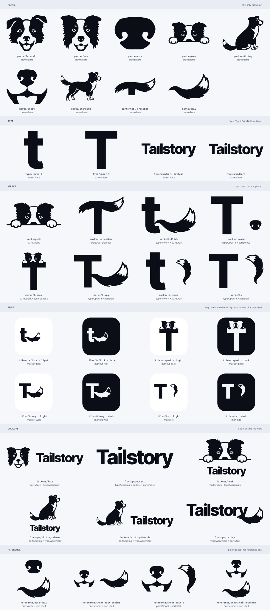

# Bailey

Tailstory's mascot, a border collie. The art is kept as small SVG files that link to each other, and `build.py` turns them into files you can use.



## Layout

| Folder | Holds |
| --- | --- |
| `parts/` | The only drawn art: Bailey standing, sitting, face, peek, tail, nose, snoot. |
| `type/` | The Tailstory wordmark and single letters, converted to outlines. |
| `marks/` | The peek mark and the monograms. Each file only places parts and letters. |
| `tiles/` | App tiles: a rounded square plus one mark. |
| `lockups/` | A part beside the word. |
| `reference/` | Pairings kept for reference only. |
| `dist/` | Generated. One folder per theme, with the same folders inside. Never edit. |

`bailey.toml` lists the folders, the themes and the PNG sizes.

## How files link

A file places another file with a `<use>`:

```xml
<use href="../parts/tail.svg#art" x="312.35" y="149.13" width="935.29" height="575.61"/>
```

`#art` is the whole drawing in that file, fitted into the box. Moving or turning it is a `transform` on the `<use>`: the upright S tail is `parts/tail.svg` turned a quarter turn.

Design apps and GitHub's preview do not follow links between files, so anything outside `parts/` and `type/` looks empty there. Look at `dist/` instead. Chrome does follow them when the repo is served, so `python -m http.server` gives a live preview of any source file.

## Themes

Art is one colour, written as `fill="currentColor"`. A tile's square carries `class="ground"`. A theme in `bailey.toml` is the pair of colours those two become:

```toml
[themes.dark]
ink = "#F3F5FA"
ground = "#0B0E17"
```

A new theme is a new table. No art is copied.

## Build

```
uv run build.py
```

This rebuilds `dist/` from scratch: a self-contained SVG of every source file in every theme, PNGs at the sizes in `bailey.toml`, and `dist/sheet.svg`. Commit `dist/` with the change that caused it.

## Rules

- One tail. Every tail is `parts/tail.svg`. Never draw another.
- Change a drawing in `parts/`. Change an arrangement by moving the `<use>` in the file that places it.
- To cut one shape out of another, put a `<mask>` on a `<g>` around the art, as `marks/t-peek.svg` does. A mask on the `<use>` itself lands in the wrong place.
- The letters are outlines of Inter Tight ExtraBold, used under the SIL Open Font License (`type/OFL.txt`).
